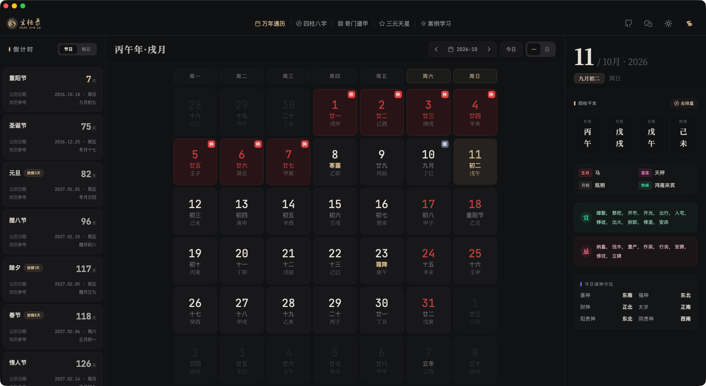
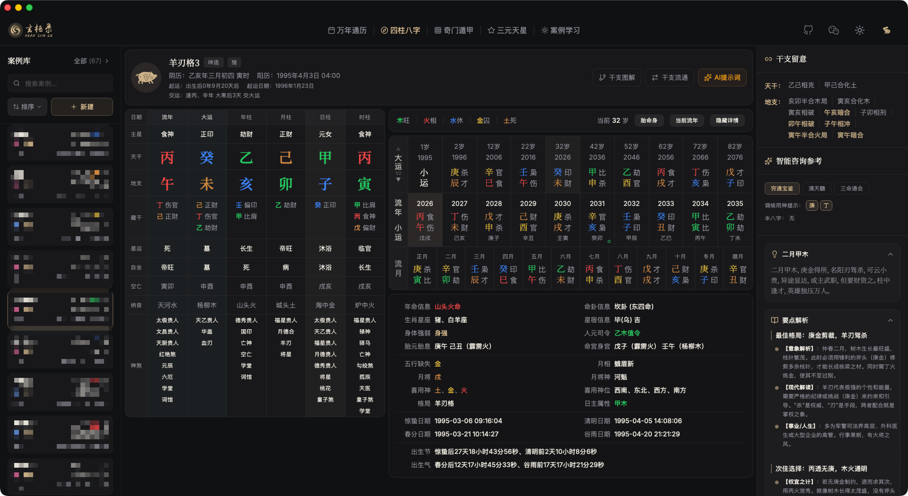
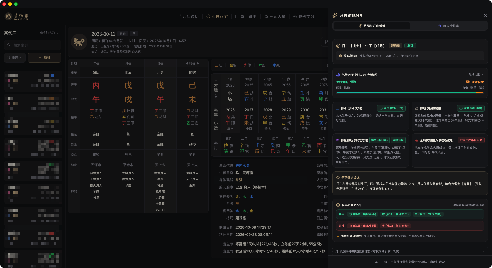
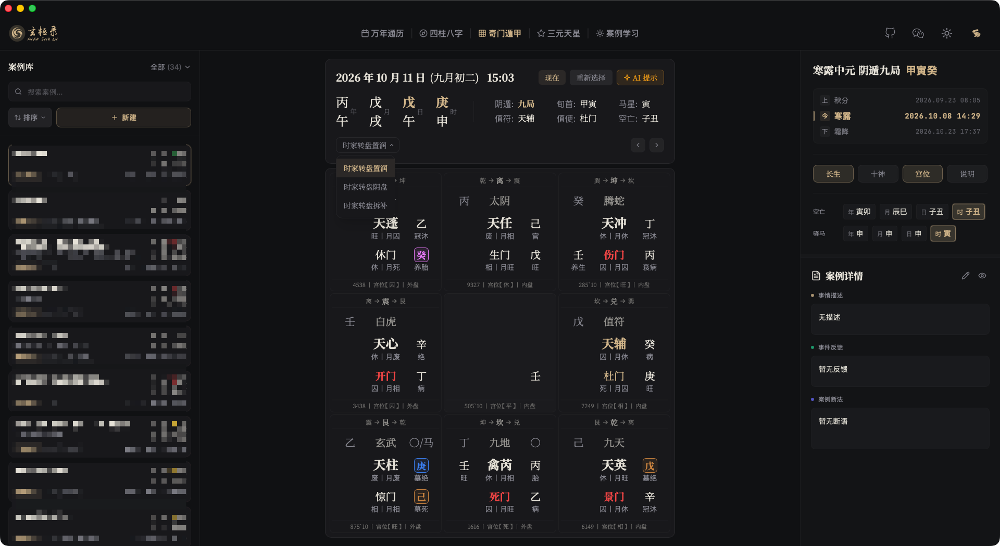
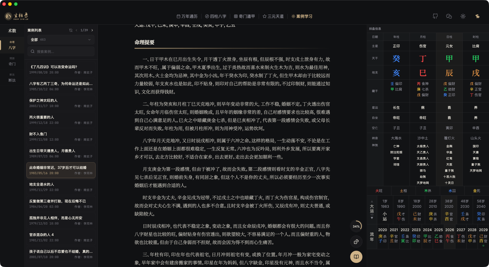
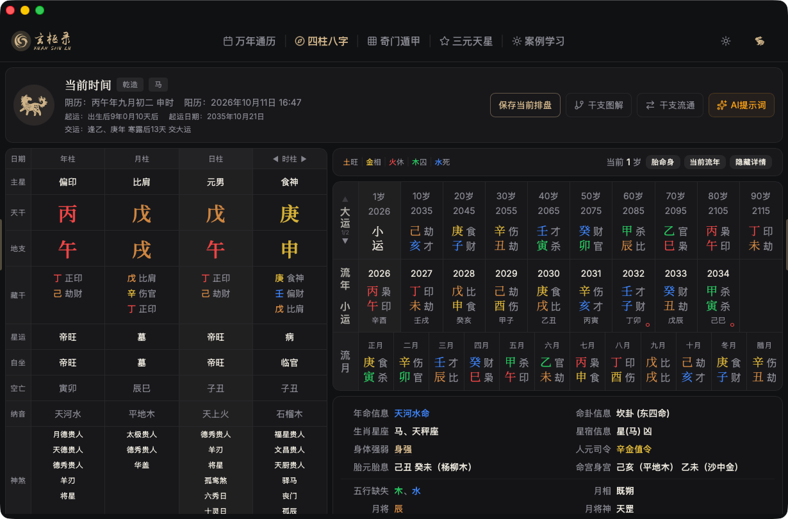
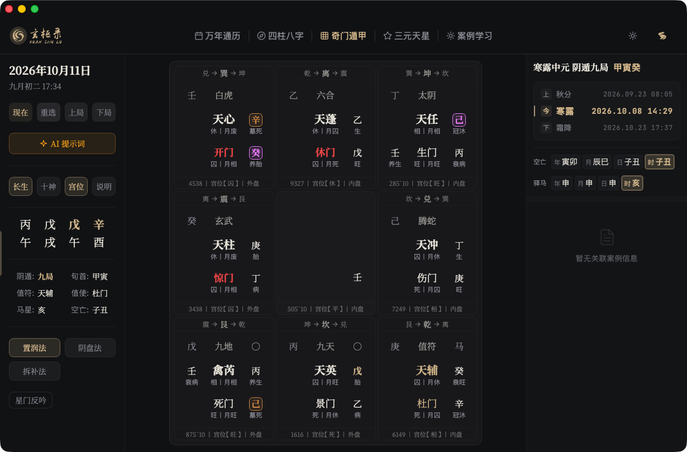
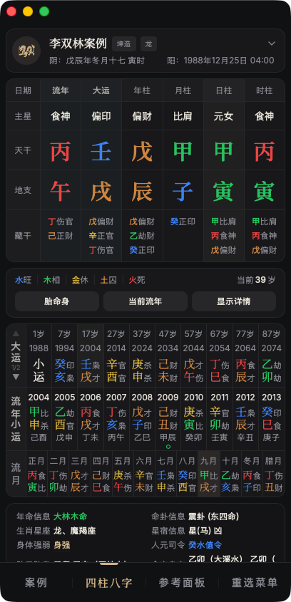
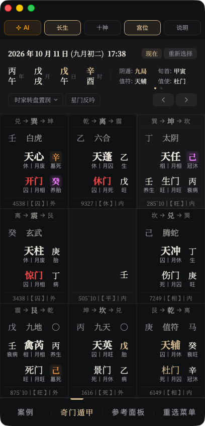
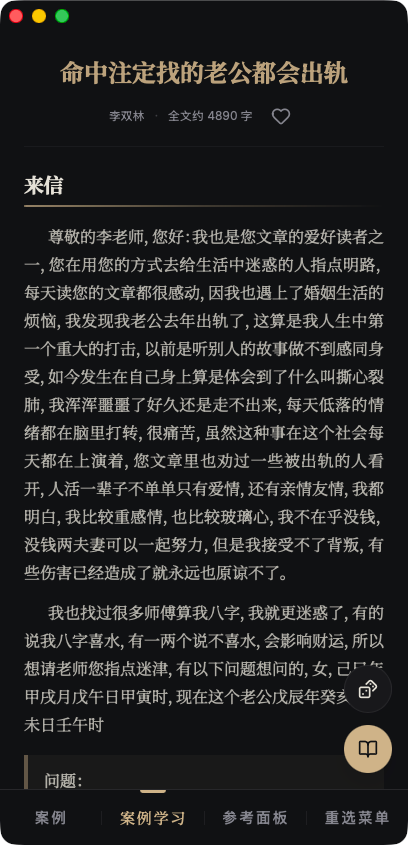

# 玄枢录（Orbis）

一款面向传统术数排盘与案例研习的跨端应用（桌面端 / 平板 / 安卓），核心是**四柱八字**与**奇门遁甲**两套盘面，外加一个以真实来信与断验为核心内容的**案例学习**体系。

排盘、案例与配置全部落在本地，不上传云端；网络仅用于可选的备份同步与 AI 推理。

---

## 作者说

本来想做一个类似「热卜」那样的综合型排盘工具，但眼下真正研习过的只有四柱八字和奇门遁甲，对六爻、梅花、大六壬这些术数的理解仍停留在表面——不清楚哪些信息是真正有用的、该不该放出来、又该以什么形式呈现，自然也做不出最优的界面。

既然自己没学深，就很难替使用者判断取舍。所以其他术数先暂缓开发，等将来研习到自认有相当熟练度的时候，再动手。

> **宁缺毋滥**：盘面不是把能算的都堆上去，而是把真正会被用到的信息，摆在该在的位置上。

---

## 界面预览

### 桌面端

**万年通历**：月历网格 + 干支、节气、宜忌、值神方位，右侧可直接「去排盘」。



**四柱八字**：天干地支、藏干、主星、星运、空亡、纳音、神煞全表，右侧联动大运 / 流年 / 流月，并给出格局与喜用神结论。



**旺衰逻辑分析**：把「为什么判身强」摊开给你看——气势天平、得令 / 得地 / 得生得助逐项判据、全局克泄耗阻力，最后落到取用与忌神指引。



**奇门遁甲**：九宫盘面含八神、九星、八门、天盘干 / 地盘干、宫位旺衰与暗干，右侧栏随时查看盘面格局与宫位详解。



**案例学习**：左侧术数与分类导航，正文逐段呈现来信、断法、反馈与总结，右侧常驻排盘信息，读断例不用来回切换。



### 平板





### 安卓

<div>



</div>

> 以上仅为节选，完整截图（桌面端 12 张、平板 4 张、安卓 6 张）见 [`docs/screenshots/`](docs/screenshots/README.md)。

---

## 功能

### 万年通历
- 月历视图，公历 / 农历 / 干支 / 节气同位显示，节假日与调休标注
- 节日倒计时、每日宜忌、值神方位、生肖星座月相物候
- 一键「去排盘」，以当前选中日期直接起盘

### 四柱八字
- 四柱全表：天干、地支、藏干、主星、星运、自坐、空亡、纳音、神煞
- 大运 / 流年 / 流月三级联动，切换即时刷新
- **干支图解**：以流年、大运与四柱交叠，标注刑冲合害等干支关系
- **干支流通**：展示生克路径与「合/生/助」「冲/刑/克/害/破」关系链
- **旺衰逻辑分析**：气势天平、得令得地得生得助诸判据、取用与忌神指引
- 智能咨询参考：经典书籍断语与调候用神提示

### 奇门遁甲
- 九宫排盘：八神、九星、八门、天盘干 / 地盘干、暗干、宫位旺衰
- 时家转盘、置闰 / 阴盘 / 拆补多种起局方式，支持自定义局数
- **盘面元素说明**：逐项解释宫位三卦、暗干、八神、九星、八门、底盘的取象依据
- 信息侧栏：格局总览、宫位详解、十干克应，随点随看

### 案例学习
- 按术数分类浏览：命理（日主 / 特殊格局）、预测（奇门按事项分类）、断法，支持关键词搜索
- 案例正文逐段呈现：来信 → 断法 → 反馈 → 总结
- 排盘信息侧栏与正文联动，阅读断例时无需切换页面
- 收藏、阅读进度自动记录

### AI 辅助
- **AI 提示词**：由盘面确定性地生成结构化提示词（真实天干透出、干支关系等锁定区），避免模型自由编造
- 可选叠加妻财子禄寿推演、大运、流年等分析模块
- 应用内多轮对话研判，或复制提示词到 DeepSeek / ChatGPT / Gemini / Kimi / 豆包等外部模型

### 数据与备份
- 单一本地工作区：Tauri 端使用 SQLite，浏览器端使用 IndexedDB
- 支持 **S3** 与 **WebDAV** 快照备份与恢复，备份文件名带来源端标识，多端共用一个目录也能分辨
- 恢复按 id 合并，不覆盖本机已有数据

---

## 技术栈

| 层 | 选型 |
|----|------|
| 前端 | React 19 + TypeScript + Vite 7 |
| 样式 | Tailwind CSS（CSS 变量 token，暗色走 `class`） |
| 桌面 / 移动壳 | Tauri 2（Rust），安卓同一套 WebView |
| 历法与八字 | lunar-typescript |
| 奇门 | 自研 `src/lib/csp-qimen`（含 WASM 初始化与结果转换） |
| 本地存储 | SQLite（Tauri） / IndexedDB（浏览器） |
| 备份 | S3（SigV4 自实现）与 WebDAV |
| 案例安全 | Ed25519 签名 + AES-256-GCM 加密包，一机一密落盘 |

---

## 快速开始

```bash
npm install
npm run dev          # 开发服务器，固定端口 9898
```

桌面端 / 安卓端调试（需本机已配置 Rust 与 Tauri 工具链）：

```bash
npm run tauri:dev
```

> 开发服务器 `/api` 默认代理到 `http://localhost:8000`。

---

## 常用脚本

```bash
npm run dev            # 启动开发服务器
npm run build          # 生产构建（tsc -b && vite build）
npm run preview        # 本地预览构建产物
npm run lint           # ESLint 检查
npx tsc -b             # 类型检查
npm test               # Vitest 前端测试
cargo test             # 在 src-tauri 内运行 Rust 安全层测试

npm run tauri:build          # 桌面端构建（普通版）
npm run tauri:build:admin    # 桌面端构建（管理员版，仅作者本机）
npm run android:build:debug  # 安卓 debug 包
```

案例语料与加密包相关（作者端工具，需私有仓 orbis-lore）：

```bash
npm run cases:unpack    # 解密加密包，还原 src/data/cases 语料目录
npm run cases:pack      # 打包加密案例包
npm run cases:keygen -- sign --machine <ID>   # 签发激活码
```

---

## 目录速览

```text
Orbis/
├── src/
│   ├── components/Modules/   # 业务模块：Bazi / Qimen / Wannianli / SanYuan / CaseStudy
│   ├── lib/                  # 领域计算：xuan-bazi、csp-qimen、sanyuan、caseStudy
│   ├── services/             # 本地存储、备份与案例业务 IO
│   ├── hooks/                # 跨组件状态聚合与逻辑编排
│   └── data/cases/           # 案例语料（源库为私有仓 orbis-lore，不入主仓）
├── src-tauri/                # Tauri 壳、Rust 安全层与案例解密
├── scripts/                  # 构建、签发、语料打包工具
├── docs/screenshots/         # 全端界面截图
└── DESIGN.md / AGENTS.md     # 设计规范与工程约定
```

| 想找什么 | 去哪看 |
|----------|--------|
| 应用启动与模块切换 | `src/App.tsx` |
| 八字领域算法 | `src/lib/xuan-bazi` |
| 奇门领域算法与常量 | `src/lib/csp-qimen` |
| 本地私有存储 | `src/services/localPrivateStore.ts` |
| 案例加密与验签 | `src-tauri/src/cases/` |

---

## 说明

- 所有私有数据保存在单一本地工作区，WebDAV / S3 仅作为备份与恢复目标，不参与业务读写。
- 案例正文明文只存在于内存，不写入 localStorage、日志或明文文件。
- 当前仅有 **四柱八字**、**奇门遁甲**、**万年通历**、**三元天星** 四个盘面模块，其余术数入口待研习到位后再开放。
