# 界面截图

玄枢录三端界面截图存档。README 中只放了有代表性的几张，这里是完整集合。

| 端 | 数量 | 目录 |
|----|------|------|
| 桌面端（1920×1050） | 12 张 | [`desktop/`](desktop/) |
| 平板端（1230×810） | 4 张 | [`tablet/`](tablet/) |
| 安卓端（408×845） | 6 张 | [`mobile/`](mobile/) |

---

## 桌面端

### 万年通历 · `desktop/wannianli.png`
月历网格 + 干支、节气、宜忌、值神方位，右侧可一键「去排盘」。

### 四柱八字 · `desktop/bazi.png`
四柱全表（干支 / 藏干 / 主星 / 星运 / 空亡 / 纳音 / 神煞）与右侧大运流年流月联动。

### 案例库 · `desktop/case-library.png`
案例管理弹层：搜索、导入导出、新建、清除数据，左侧按关系分类（家人 / 恋人 / 朋友 / 父母 / 孩子 / 同事 / 领导 / 老师 / 学生 / 名人 / 其他）。

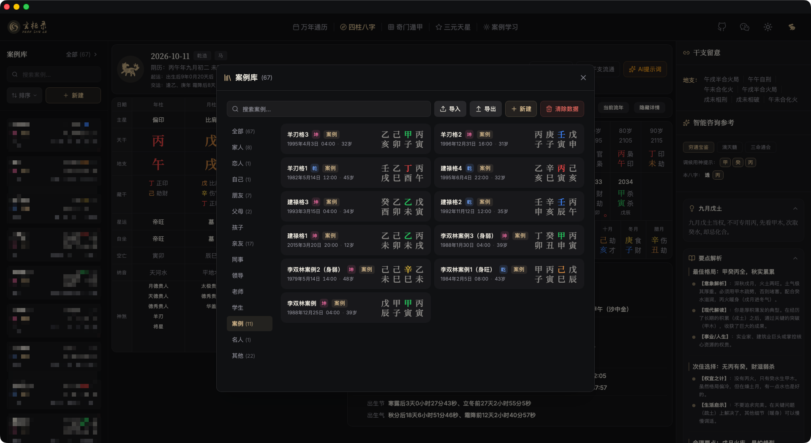

### 旺衰逻辑分析 · `desktop/bazi-wangshuai.png`
气势天平、得令 / 得地 / 得生得助判据、全局克泄耗阻力、取用与忌神指引。

### 干支图解 · `desktop/bazi-ganzhi-tujie.png`
流年、大运与四柱交叠成图，标注刑冲合害等干支关系，支持流年 / 大运切换。

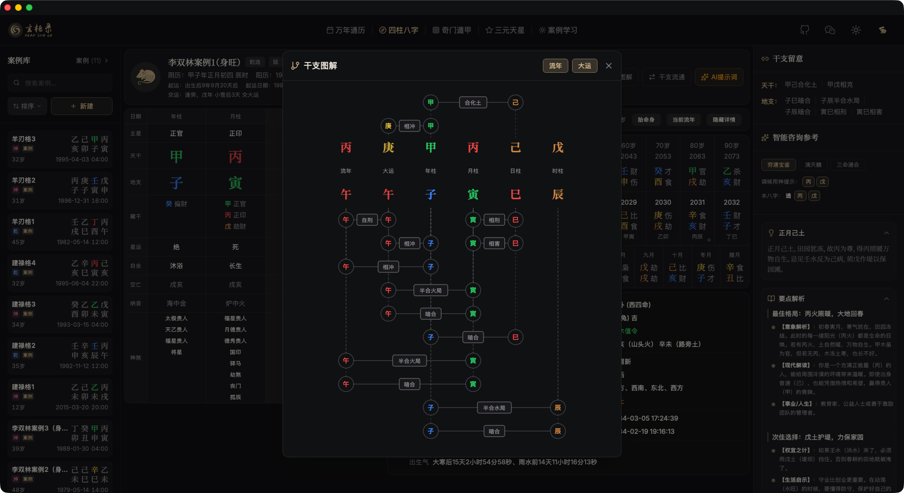

### 干支流通 · `desktop/bazi-liutong.png`
展示天干地支之间的生克路径与「合 / 生 / 助」「冲 / 刑 / 克 / 害 / 破」关系链，可点击高亮。

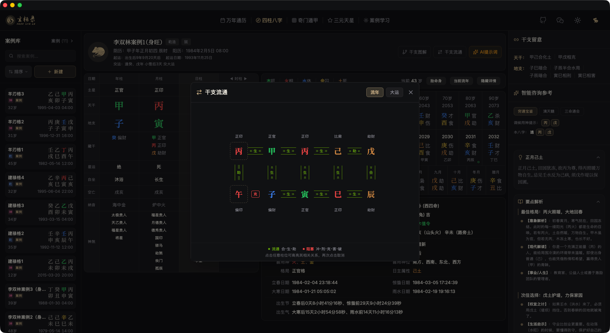

### AI 提示词 · `desktop/bazi-ai-prompt.png`
由盘面确定性生成结构化提示词，并可选叠加妻财子禄寿推演、大运、流年分析模块。

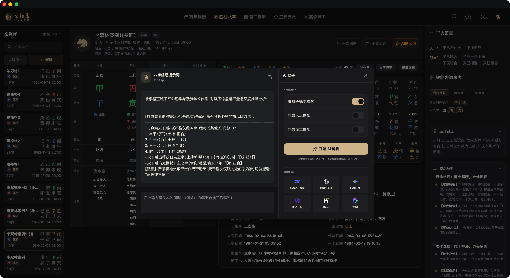

### 奇门遁甲 · `desktop/qimen.png`
九宫盘面：八神、九星、八门、天盘干 / 地盘干、宫位旺衰。

### 奇门遁甲 · 信息侧栏 · `desktop/qimen-sidebar.png`
格局总览、宫位详解与十干克应，随点随看。

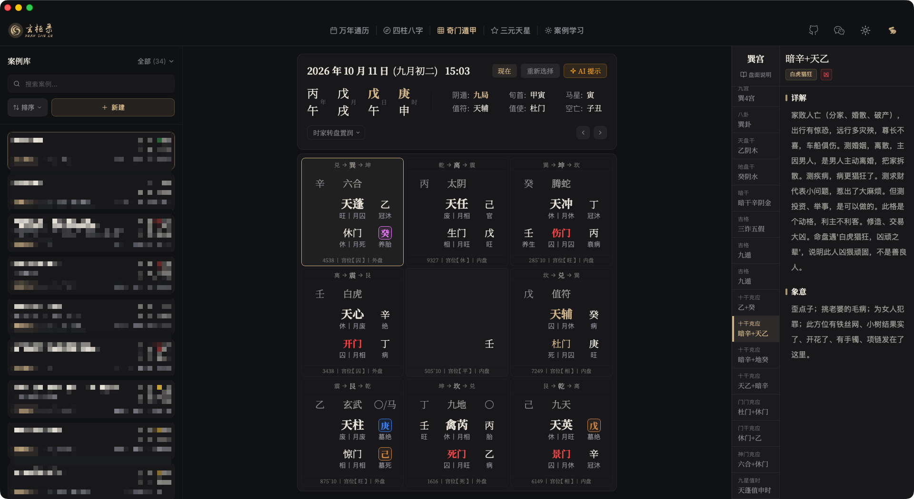

### 奇门遁甲 · 盘面元素说明 · `desktop/qimen-elements.png`
逐项解释宫位三卦、暗干、八神、九星、八门、天干地支、底盘数字、宫位与内盘外盘的取象依据。

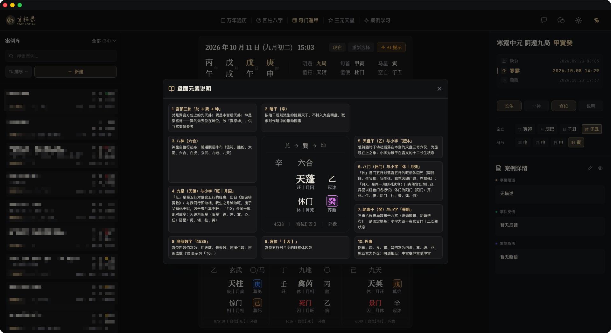

### 案例学习（八字）· `desktop/case-study-bazi.png`
左侧术数与分类导航，正文逐段呈现，右侧常驻排盘信息。

### 案例学习（奇门遁甲）· `desktop/case-study-qimen.png`
奇门断例同样以「来信 / 反馈 / 总结 / 断法」结构呈现，右侧为对应排盘。

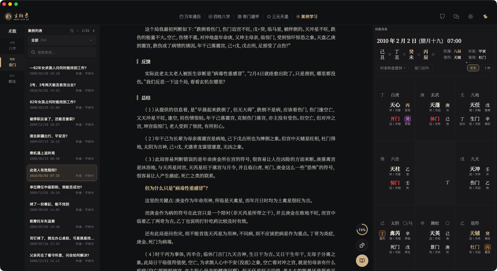

---

## 平板端

### 四柱八字 · `tablet/bazi.png`
宽屏下的横排布局：左侧案例列表，中部盘面，右侧干支留意与智能咨询参考。

### 奇门遁甲 · `tablet/qimen.png`
左侧起盘控制与干支信息，中部九宫盘，右侧格局结论。

### 案例学习（八字）· `tablet/case-study-1.png`
目录侧栏展开状态，按术数、分类与关键词定位案例。

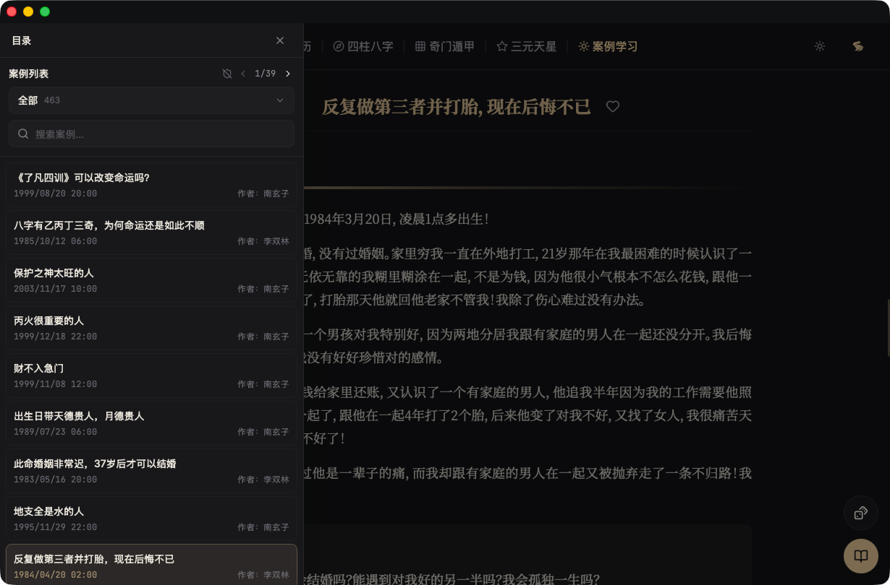

### 案例学习（八字）· `tablet/case-study-2.png`
排盘信息侧栏与正文并排，阅读断例时同步看盘。

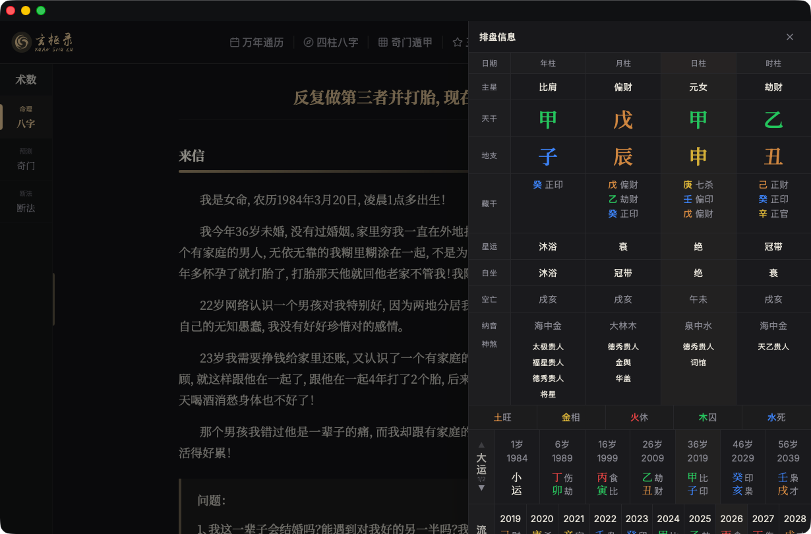

---

## 安卓端

### 四柱八字 · `mobile/bazi.png`
窄屏盘面，底部 Tab 栏可自定义槽位。

### 奇门遁甲 · `mobile/qimen.png`
九宫盘在窄屏下的紧凑排布，顶部为起局参数与 AI 入口。

### 奇门遁甲 · 盘面元素 · `mobile/qimen-elements.png`
盘面元素说明在移动端的卡片式呈现。

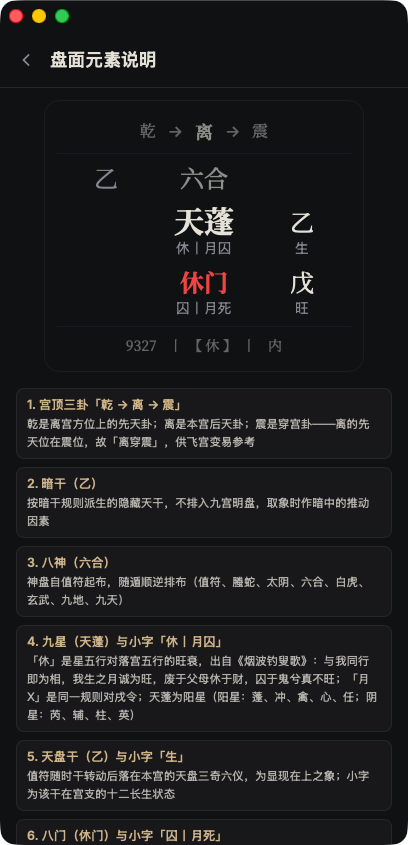

### 案例学习 · `mobile/case-study.png`
移动端案例阅读视图。

### 四柱八字 · AI 解析 · `mobile/bazi-ai.png`
移动端 AI 提示词与外部模型入口。

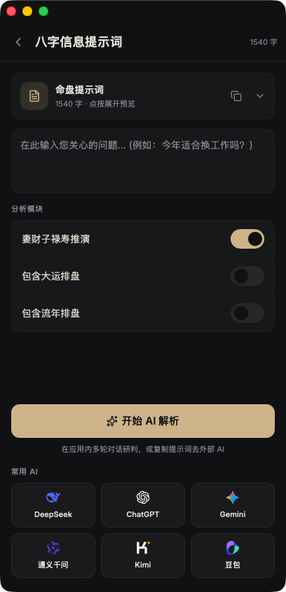

### 个人中心 · `mobile/profile.png`
底部菜单槽位管理、外观切换、设置生日、案例与断法入口、对话历史、AI 集成、数据与服务。

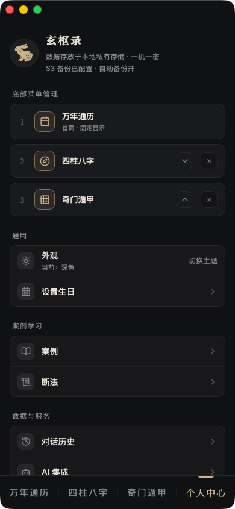
